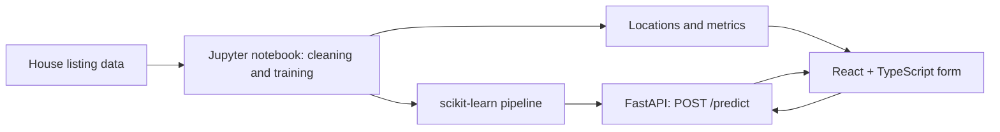

# 🏠 House Price Prediction — End-to-End ML Web App

A portfolio project that turns property listing details into a price estimate through a scikit-learn model, a FastAPI backend, and a React + TypeScript frontend. The repository also includes a Jupyter notebook for cleaning data, engineering features, comparing regressors, and exporting the fitted pipeline.

> **Learning prototype:** the included generator creates synthetic example data; the generated CSV is not committed. Any metrics shown below come from synthetic data and do not measure real-world pricing accuracy. Do not use these predictions to value a real property.

## Data

The notebook is designed for the [House Price dataset by Juhi Bhojani](https://www.kaggle.com/datasets/juhibhojani/house-price), which contains Indian property listings. For a local walkthrough, generate the small synthetic dataset with `notebooks/data/generate_synthetic_data.py`. Replace it with the real dataset and retrain before interpreting model performance. The notebook expects the same column schema.

## How it works



The notebook compares Linear Regression, Random Forest, and Gradient Boosting, then exports the selected pipeline and supporting files. The API exposes `GET /health` and validated `POST /predict` endpoints; the frontend submits a listing and displays the estimate.

## Technology

- **Data and ML:** Python, pandas, NumPy, scikit-learn, Jupyter, matplotlib, seaborn
- **API:** FastAPI, Pydantic, Uvicorn, joblib
- **Frontend:** React, TypeScript, Vite, React Router

## Run locally

Run the commands below from the repository root. Python 3.11+ and Node.js 18+ are recommended. Start the API and frontend in separate terminals.

### Train the model

```bash
cd house-price-project/notebooks
python -m venv .venv
source .venv/bin/activate  # Windows: .venv\Scripts\activate
pip install jupyter pandas numpy scikit-learn matplotlib seaborn joblib
python data/generate_synthetic_data.py
jupyter notebook house_price_model.ipynb
```

In the notebook, use **Kernel → Restart & Run All**. To evaluate real listings, download the Kaggle data and replace the generated input before training. The notebook exports the model and supporting files used by the backend.

### Start the API

```bash
cd house-price-project/backend
python -m venv .venv
source .venv/bin/activate  # Windows: .venv\Scripts\activate
pip install -r requirements.txt
cp .env.example .env
uvicorn app.main:app --reload
```

Open [http://localhost:8000/docs](http://localhost:8000/docs) for the interactive API documentation. Set `MODEL_PATH`, `LOCATIONS_PATH`, or `ALLOWED_ORIGINS` in `backend/.env` when needed.

### Start the frontend

```bash
cd house-price-project/frontend
npm install
cp .env.example .env
npm run dev
```

The default API URL is `http://localhost:8000`; configure `VITE_API_BASE_URL` in `frontend/.env` if it differs.

## API example

```bash
curl -X POST http://localhost:8000/predict \
  -H "Content-Type: application/json" \
  -d '{"location":"Sector 12, Noida","carpet_area_sqft":1200,"floor_num":3,"bathroom":2,"balcony":1,"furnishing":"Semi-Furnished","transaction":"Resale","ownership":"Freehold","facing":"East"}'
```

Invalid inputs are rejected with a validation response. See the API docs for the request and response schemas.

## Model results and limits

The repository currently records a held-out split and 5-fold cross-validation across three regressors. The displayed example metrics (MAE ₹33.75 lakh, RMSE ₹49.49 lakh, R² 0.42) were calculated on the generated synthetic dataset. They are included only as a pipeline example; they are not evidence of useful performance on real listings. Data source, location coverage, time period, and listing quality can change results substantially.

This is a local learning project, not a deployed valuation service. The repository includes backend tests; run them with `cd house-price-project/backend && pytest -v`. The tests and frontend build have not been independently verified as part of this documentation update.

## Project layout

```text
house-price-project/
├── notebooks/  # data generation and model-training notebook
├── backend/    # FastAPI app, exported model files, tests, Dockerfile
└── frontend/   # React + TypeScript app
```

See the [root README](../README.md) for the project overview and quick-start commands.
