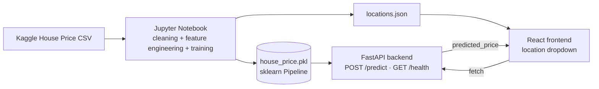

# 🏠 House Price Prediction — End-to-End ML Web App

An end-to-end machine learning product: a Jupyter notebook that cleans real-estate
data and trains a regression model, a **FastAPI** backend that serves it, and a
**React + TypeScript** frontend where a user enters property details and gets an
instant price estimate.

> **Dataset:** [House Price by Juhi Bhojani](https://www.kaggle.com/datasets/juhibhojani/house-price) (Kaggle, ~187k Indian property listings).
> This repo ships with a small **synthetic** `house_prices.csv` (same columns/format,
> generated by `notebooks/data/generate_synthetic_data.py`) so the whole pipeline runs
> out of the box without a Kaggle account. **Swap in the real dataset** (see
> [Phase 1](#1-download-the-dataset)) before treating the results as meaningful.

---

## Overview

| | |
|---|---|
| **Notebook** | Cleans messy real-estate data (`"42 Lac"`, `"1200 sqft"`, `"3 out of 10"`, …), engineers features, trains & compares 3 regression models, exports a single scikit-learn `Pipeline` (`house_price.pkl`) |
| **Backend** | FastAPI service that loads the pipeline once at startup and exposes `POST /predict` + `GET /health` |
| **Frontend** | React + TypeScript + Vite form → calls the API → shows the predicted price |

## Architecture



## Tech stack

- **Data / ML:** Python, pandas, numpy, scikit-learn, matplotlib, seaborn, Jupyter
- **Backend:** FastAPI, Pydantic v2 / pydantic-settings, Uvicorn, joblib, pytest
- **Frontend:** React 18, TypeScript, Vite, React Router

## Project structure

```
house-price-project/
├── notebooks/
│   ├── house_price_model.ipynb     # full training notebook (§2.1 – §2.6)
│   └── data/
│       ├── generate_synthetic_data.py
│       └── house_prices.csv        # NOT committed — see "Download the dataset"
├── backend/
│   ├── app/
│   │   ├── main.py                 # FastAPI app, CORS, model loaded at startup (lifespan)
│   │   ├── api/routes/prediction.py# GET /health, POST /predict
│   │   ├── core/config.py          # Settings from .env (pydantic-settings)
│   │   ├── schemas/prediction.py   # PredictionRequest / PredictionResponse
│   │   ├── services/
│   │   │   ├── preprocessing.py    # Turn a request into a one-row DataFrame
│   │   │   └── inference.py        # Load .pkl, run predict
│   │   └── utils/logging_config.py
│   ├── models/
│   │   ├── house_price.pkl         # ← produced by the notebook
│   │   ├── locations.json
│   │   └── metrics.json
│   ├── tests/test_prediction.py
│   ├── requirements.txt
│   ├── .env.example
│   └── Dockerfile
├── frontend/
│   ├── src/
│   │   ├── api/predictionClient.ts
│   │   ├── components/PredictionForm.tsx
│   │   ├── pages/{HomePage,ResultPage,NotFoundPage}.tsx
│   │   ├── types/prediction.ts
│   │   └── App.tsx
│   ├── public/locations.json
│   ├── .env.example
│   └── package.json
├── .gitignore
└── README.md
```

---

## Phase 0 — Prerequisites

| Tool | Minimum version | Check with |
|---|---|---|
| Python | 3.11 | `python --version` |
| Node.js + npm | 18 | `node --version` |
| Git | any recent | `git --version` |
| Kaggle account (optional, for the real dataset) | — | https://www.kaggle.com |

---

## 1. Download the dataset

The repo ships with a **synthetic** `house_prices.csv` so you can run everything
immediately. To train on the **real** Kaggle data:

**Option A — manual:** download from
https://www.kaggle.com/datasets/juhibhojani/house-price, unzip, and overwrite
`notebooks/data/house_prices.csv`.

**Option B — Kaggle CLI:**
```bash
pip install kaggle
# Get your API token: Kaggle → Settings → API → "Create New Token"
# Place kaggle.json in C:\Users\<you>\.kaggle\ (Windows) or ~/.kaggle/ (macOS/Linux)
kaggle datasets download -d juhibhojani/house-price -p notebooks/data --unzip
```

No notebook code changes are needed — the real file uses the same column names.

## 2. Run the notebook

```bash
cd notebooks
python -m venv .venv
source .venv/bin/activate      # .venv\Scripts\activate on Windows
pip install jupyter pandas numpy scikit-learn matplotlib seaborn joblib
jupyter notebook house_price_model.ipynb
# Kernel → Restart & Run All
```

This regenerates `backend/models/house_price.pkl`, `locations.json`, and
`metrics.json`.

## 3. Run the backend

```bash
cd backend
python -m venv .venv
source .venv/bin/activate      # .venv\Scripts\activate on Windows
pip install -r requirements.txt
cp .env.example .env
uvicorn app.main:app --reload
# open http://localhost:8000/docs
```

### Backend environment variables (`backend/.env`)

| Variable | Default | Description |
|---|---|---|
| `APP_NAME` | `House Price Prediction API` | Display name |
| `MODEL_PATH` | `models/house_price.pkl` | Path to the exported pipeline |
| `LOCATIONS_PATH` | `models/locations.json` | Known locations for the frontend dropdown |
| `ALLOWED_ORIGINS` | `http://localhost:5173` | Comma-separated CORS origins |

### Run the tests

```bash
pytest -v
```

## 4. Run the frontend

```bash
cd frontend
npm install
cp .env.example .env
npm run dev
# open http://localhost:5173
```

### Frontend environment variables (`frontend/.env`)

| Variable | Default | Description |
|---|---|---|
| `VITE_API_BASE_URL` | `http://localhost:8000` | Backend base URL |

With the backend on `:8000` and the frontend on `:5173`, fill out the form and
submit to see a real prediction end to end.

---

## API reference

### `GET /health`
```bash
curl http://localhost:8000/health
# {"status":"ok"}
```

### `POST /predict`
```bash
curl -X POST http://localhost:8000/predict \
  -H "Content-Type: application/json" \
  -d '{
        "location": "Sector 12, Noida",
        "carpet_area_sqft": 1200,
        "floor_num": 3,
        "bathroom": 2,
        "balcony": 1,
        "furnishing": "Semi-Furnished",
        "transaction": "Resale",
        "ownership": "Freehold",
        "facing": "East"
      }'
# {"predicted_price": 9985804.80}
```

Invalid input (e.g. `carpet_area_sqft <= 0`) returns HTTP `422` with a
Pydantic validation error.

---

## Model metrics

Trained on the bundled **synthetic** dataset (regenerate with the real Kaggle
data for meaningful numbers). Winning model: **GradientBoostingRegressor**,
trained on `log1p(price)` and inverted with `expm1` at inference time.

| Metric | Value |
|---|---|
| MAE | ₹ 33.75 Lac |
| RMSE | ₹ 49.49 Lac |
| R² | 0.42 |

Three models were compared (`LinearRegression`, `RandomForestRegressor`,
`GradientBoostingRegressor`) on an 80/20 train/test split plus 5-fold
cross-validation; see §2.5 of the notebook for the full comparison table and
the predicted-vs-actual plot.

---

## Screenshots

*(Add your own screenshots here once you run the app locally — e.g.
`docs/form.png` and `docs/result.png` — and reference them below.)*

```md


```

---

## Deliverables checklist

- [x] `notebooks/house_price_model.ipynb` — runs top-to-bottom (Kernel → Restart & Run All), with EDA plots, cleaning, ≥ 2 models compared, test metrics, and model export.
- [x] `backend/` — FastAPI app with `/health` + `/predict`, `.env.example`, pinned `requirements.txt`, passing `pytest`.
- [x] `frontend/` — React form → result page, `.env.example`, `npm run build` succeeds.
- [x] `models/house_price.pkl` served by the backend and produced by the notebook.
- [x] Root `README.md`.
- [ ] Public GitHub repository with a clean history (no `node_modules`, no `.venv`, no `.env`, no raw CSV) — **push this yourself**.
- [x] End-to-end demo works: form → API → model → predicted price on screen.

## Common pitfalls (avoided here)

- `.env` files and the raw dataset CSV are `.gitignore`d.
- The notebook runs cleanly top-to-bottom (`Kernel → Restart & Run All`).
- `backend/requirements.txt` pins `scikit-learn` to the exact version used to
  train the pickle (see the "Version pinning" note in §2.6 of the notebook).
- The frontend reads the API URL from `VITE_API_BASE_URL`, never hard-coded.
- Metrics above are reported on the **held-out test set**, not the training set.

---

Good luck — build something you'd be proud to pin on your GitHub profile! 🚀
